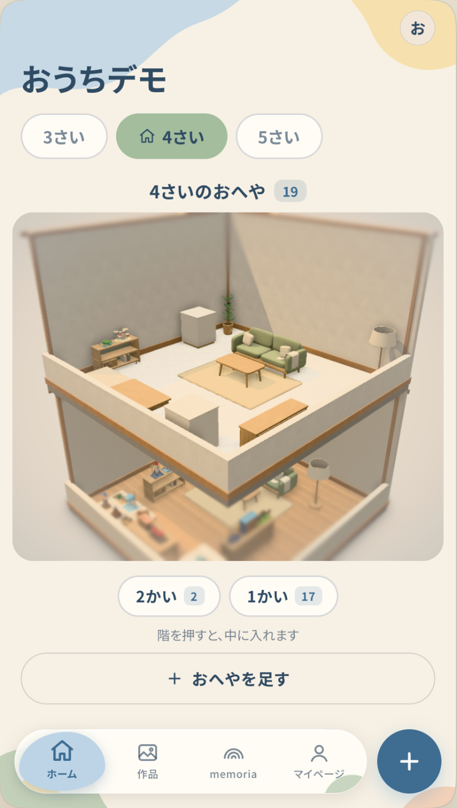
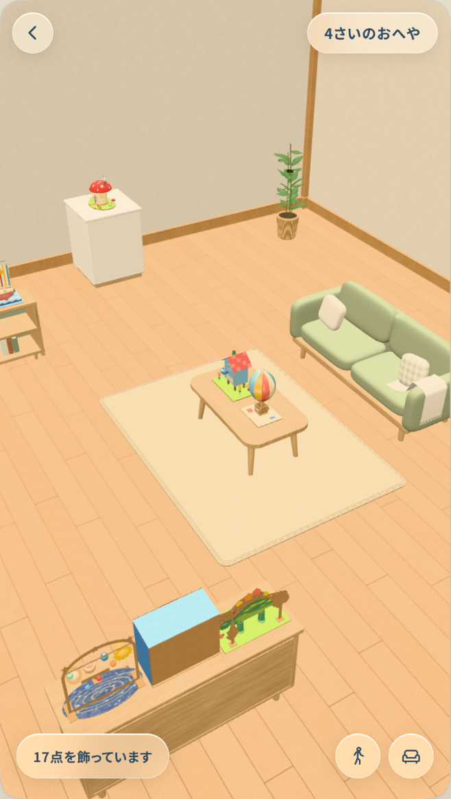
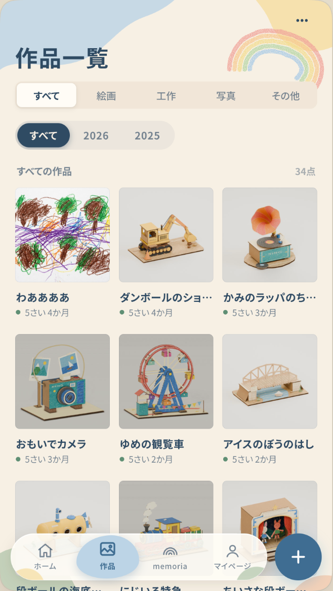
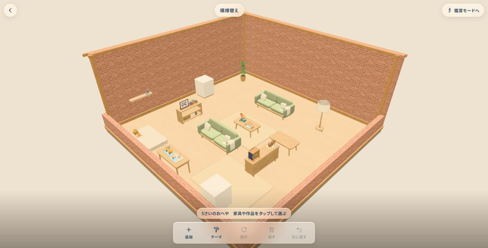
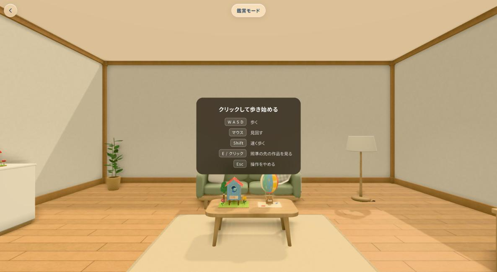

# memoria（おもいでミュージアム）

**デモ**：https://memoria-sasu.onrender.com （ブラウザで開くだけで見られます。スマホにも対応しています。しばらく誰も開いていないと、起きるまで 1 分ほどかかります）

## 製品概要
子どもが作った絵や工作を、3D のおうちの「おへや」に飾って保管できる、家族のための思い出のミュージアムです。作品は「作ったときの年齢」ごとのおへやに並び、作品にまつわるエピソードや写真・動画・声も一緒に残せるので、成長の記録としていつでも振り返れます。

  
  &nbsp;
  
  &nbsp;
  

ホーム（年齢ごとのおへや） ／ おへやの中 ／ 作品一覧（作ったときの年齢つき）

### 背景(製品開発のきっかけ、課題等）
子どもは毎日のように絵を描いたり、工作をしたりします。どれも大切な思い出ですが、家にはすべてを飾る場所も、しまっておく場所もありません。結局、写真に撮って処分することが多くなります。

けれども、スマホのカメラロールに入った写真は、ほかの写真に埋もれてしまいます。いつ・何歳のときに作ったのかも分からなくなり、見返すことはほとんどありません。
「作品を手元に残しておきたい」「成長の記録として見返したい」という気持ちと、「置き場所が無い」という現実のあいだを埋めたい、というのがきっかけです。

### 製品説明（具体的な製品の説明）
1. **子どもの作品を、3D の作品（GLB ファイル）にします。** 作品の写真を撮る（その場で撮影するか、写真を選ぶ）と、サーバーが写真から GLB を作ります。
   - 絵や写真は、写真の縦横に合う額縁（縦長・横長・正方形）を選び、写真を切り抜いてオークの額縁に入れた GLB にします。
   - 工作は、写真を貼ったアクリルスタンドの形の GLB にします。
   - 3D スキャンのアプリなどで作った GLB があれば、立体のまま飾れます（写真が無ければ、GLB を撮った画像を一覧の写真に使います）。
2. **作った GLB を、おへやに自動で配置します。** 子どもの生年月日と作った日から「作ったときの年齢」を計算し、その年齢の **おへや** に飾ります。
   - 額縁は部屋の壁に掛け、立体の作品は棚や机の上に置きます。
   - 作品の実際の大きさを GLB から測り、置き場所に合わせて大きさをそろえ、ほかの作品と重ならない場所を選びます。
3. ホームでは、年齢ごとのおへやが、机の上の模型（ジオラマ）のように積み上がった建物として見えます。階を押すと、そのおへやの中に入れます。
4. おへやの中は 3D で、ドラッグで見回せます。作品を押すと詳しい情報が出ます。一人称で歩いて見て回る「鑑賞モード」もあります。
5. 模様替えで、家具を置いたり、壁紙や床を変えたり、作品を好きな棚や机に動かしたりできます。
6. **作品ごとに、そのときの思い出を一緒に残せます。** 作品にコメント（作ったときのエピソード）や、作っているときの写真・動画、作品について話す子どもの声を **おもいで** として結びつけて保管し、作品を開けばいつでも振り返れます。

### 特長
#### 1. 作品が「おへや」に飾られる
写真を並べるだけのアルバムではなく、棚・机・壁の飾り棚に、作品がそれぞれの大きさに合わせて並びます。作品が増えたら、おへやを足して階を積み上げられます。

  

模様替え。家具や作品をドラッグで動かし、壁紙や床を変えられる

#### 2. 年齢ごとに、成長が見える
作品は「4さい 3か月」のように作ったときの年齢で分かれます。3さい・4さい・5さいとおへやを見比べると、成長の跡が自然に見えてきます。作品一覧でも、月ごとに年齢と一緒に並びます。

#### 3. 歩いて見て回れる
スマホでも PC でも、ミュージアムのように一人称で歩いて作品を見て回れます（鑑賞モード）。

  

#### 4. 作品と一緒に、そのときの感動や思い出を残せる
作品はただの「物」ではなく、作ったときの出来事や、そのときの気持ちと一緒にあるものです。memoria では、作品ごとに次のような **おもいで** を結びつけて残せます。

- **コメント**：「おかあさんの誕生日に描いたよ」のような、作ったときのエピソード
- **写真・動画**：夢中で作っている様子や、できあがって喜ぶ顔
- **声**：作品について話す子どもの声（アプリの中でそのまま録音できる）

作品を開けば、そのときの声や様子がいっしょに出てくるので、何年たっても「このとき、こんなことを話していたね」と振り返れます。作品の 3D には、おもいでのある作品に小さな印が付きます。

### 解決出来ること
- 実物を全部とっておけなくても、作品を「飾ってある」状態で残せます。
- 「いつ・何歳で作ったか」が自動で整理されるので、あとから見返しやすくなります。
- 作品そのものだけでなく、作ったときのエピソード・様子・声まで一緒に残るので、そのときに感じた感動や思い出が消えずに残ります。
- 遠くに住む祖父母なども、URL を開くだけで子どもの作品を見に来られます（招待状の画面を用意しています）。

### 今後の展望
- 写真から 3D モデルを作る処理を、本格的な 3D 復元に置き換える（今は、写真を額縁やアクリルスタンドの形にしています）。
- ログインと家族の共有（招待状から家族として参加し、同じミュージアムを一緒に育てる）。
- 写真・3D・おもいでのファイルをクラウドのストレージに置き、どの端末からでも同じ作品が見られるようにする。
- 増築など、おへやの形や大きさを選べるようにする。

### 注力したこと（こだわり等）
* **「飾る」体験**：作品が浮いたり重なったりしないよう、家具ごとに作品を置ける面を測り、作品の実寸から置ける場所を決めています。模様替えで「置ける（緑）」と表示された場所は、保存でも必ず通ります（サーバーと画面で同じ計算を持ち、4,900 件の総当たりで一致を確かめています）。
* **年齢ごとのおへや**：生年月日を変えたり、作った日を直したりすると、作品が正しい年齢のおへやへ自動で移ります。
* **ホームの見た目**：積み上がったおへやを、暖かい光の影・接地の影・ティルトシフトで、机の上の模型のように見せています。
* **スマホで軽く動くこと**：作品の画像を小さくし、スマホでは重い効果を省き、変化があるときだけ描き直しています。

## 開発技術
### 活用した技術
#### API・データ
* PostgreSQL（Supabase）：作品・おへやごとの配置・設定・おもいでの記録
* 自前の REST API（Rust）：作品の登録・3D モデルの生成・おへやの配置の検証と保存・年齢の計算

#### フレームワーク・ライブラリ・モジュール
* フロントエンド：React 19・Vite・TypeScript・TanStack Query・React Router
* 3D：three.js・React Three Fiber・drei（GLB の読み込み、影、ポストエフェクト）
* バックエンド：Rust・axum・sqlx・tokio・image（写真の縮小と GLB の生成）
* 録音：MediaRecorder API
* 公開：Docker・Render

#### デバイス
* スマートフォン（iPhone・Android）のブラウザ：撮影・録音・タッチでの見回し
* PC のブラウザ：キーボードとマウスで鑑賞モードを歩く

### 独自技術
#### ハッカソンで開発した独自機能・技術
* **写真を額縁に入れた 3D の作品にする処理**（[`backend/src/glb.rs`](backend/src/glb.rs)）：写真の縦横に合わせてオークの額縁（縦長・横長・正方形）を選び、写真を切り抜いて額縁の GLB に埋め込みます。工作はアクリルスタンド風の GLB を組み立てます（どちらも写真を板に貼った簡易版で、立体の復元はしていません）。
* **作品の置き場所の決まりを、サーバーと画面で共有**（[`backend/src/home.rs`](backend/src/home.rs)・[`web/src/three/scenes/home/placement.ts`](web/src/three/scenes/home/placement.ts)）：家具の面の区切り方・作品の大きさ・壁や家具との重なりを同じ計算で判定します。総当たり表 [`backend/src/testdata/placement-cases.json`](backend/src/testdata/placement-cases.json) で、両方の結果が 1 件も違わないことを確かめています。
* **年齢ごとのおへや**（PR #11 `2d73a4a`）：作品の年齢を計算し、おへやをまたいで作品を置き直す処理（[`backend/src/age.rs`](backend/src/age.rs)・[`backend/src/home_api.rs`](backend/src/home_api.rs)）。
* **作品のおもいで**（PR #16 `b8b6761`）：写真・動画・声の記録と、アプリでの録音（[`backend/src/memories.rs`](backend/src/memories.rs)・[`web/src/components/MemorySection.tsx`](web/src/components/MemorySection.tsx)）。
* **ジオラマのように見せるホーム**（PR #21 `669c98e`）：積み上げたおへやの影・接地の影・隅の陰・ティルトシフト（[`web/src/three/scenes/StackScene.tsx`](web/src/three/scenes/StackScene.tsx)・[`web/src/three/scenes/DioramaEffects.tsx`](web/src/three/scenes/DioramaEffects.tsx)）。

開発の手順・仕組みは [docs/development.md](docs/development.md)、公開の手順は [docs/deploy.md](docs/deploy.md) にあります。
