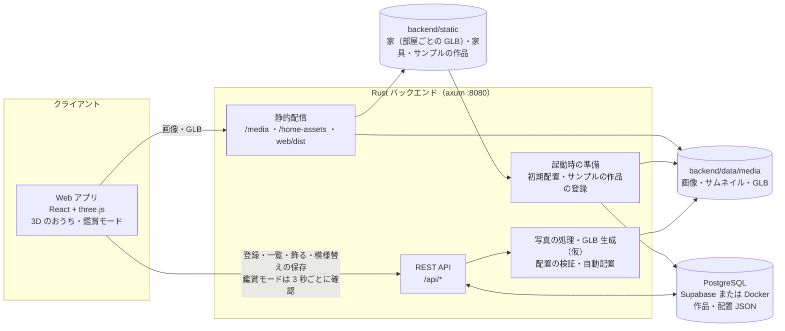
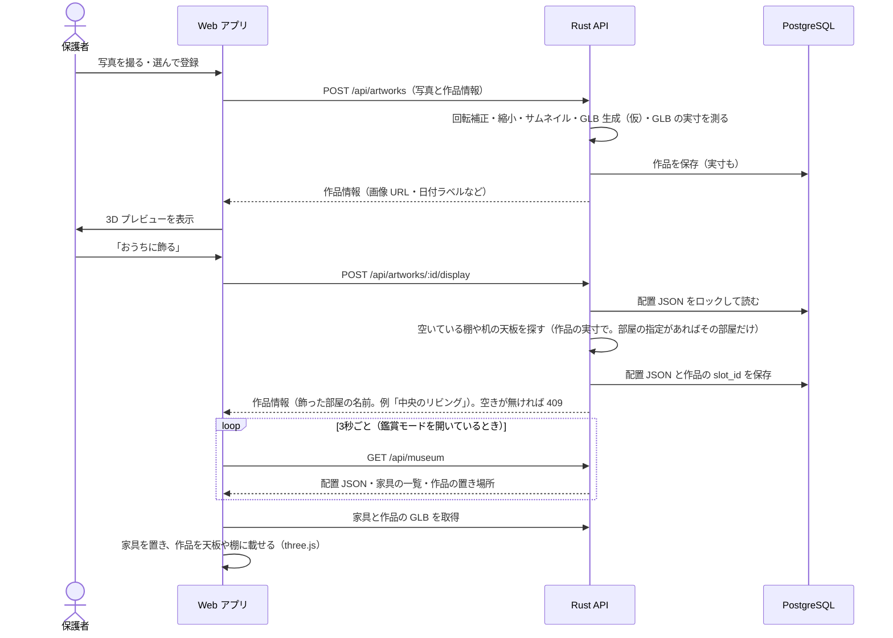

# 開発ガイド（おもいでミュージアム）

リポジトリ直下の [README.md](../README.md) は JPHACKS の提出用です。アプリの仕組み・起動方法・API はこのファイルにまとめています。

子どもの絵や工作を写真に撮って登録すると、3D のおうちに飾れるアプリです。
Web で写真を登録すると Rust のサーバーが 3D モデル（GLB）を作り、「おうちに飾る」を押すと、Web の 3D のおうち（three.js）の棚や机の上に並びます。おうちは 4 部屋（中央のリビングと、左・右・前の部屋）です。アプリのホームは、この 3D のおうちそのもの（画面いっぱい）で、ドラッグで見回せて、放っておくとゆっくり回り、作品をタップすると詳細が開きます。PC とスマホのブラウザで、家の中を一人称で歩いて、部屋から部屋へ見て回れます（鑑賞モード）。
家具と作品の置き場所は、配置 JSON としてデータベースに保存しています。模様替えの画面で、部屋ごとに家具や作品を動かす・回す・消す・足す、壁紙と床材（テーマ）を選ぶ、ができます。初回の起動で、サンプルの作品 13 点（アトリエ）が登録され、中央のリビングに飾られます。
3D の表示は Web（three.js）だけで完結しています。

関連ドキュメント：

- [docs/frontend.md](./frontend.md)：Web（フロントエンド）の構成と、変更するときの決まり
- [docs/supabase.md](./supabase.md)：データベースを Supabase に移したときの作業の記録
- [docs/walk.md](./walk.md)：鑑賞モード（家の中を three.js で一人称で歩く画面）の作り
- [docs/house-assets.md](./house-assets.md)：4 部屋の家の建物 GLB の仕様（本番の GLB を作ってもらうときに渡す）
- [tools/home-rooms/README.md](../tools/home-rooms/README.md)：開発用の建物 GLB（今入っているもの）の作り方
- [backend/static/atelier/README.md](../backend/static/atelier/README.md)：サンプルの作品 13 点の出どころと、モデルの縮め方
- [AGENTS.md](../AGENTS.md)：AI エージェント向けの作業メモ（構成・守ること）

## システム構成



| 担当 | 役割 |
|---|---|
| Rust | 写真の回転補正・縮小・サムネイル作成、写真から GLB の生成（仮の実装）、作品の GLB の実寸の計測、家の部屋の定義（4 部屋の位置・大きさ・出入口。`backend/src/home.rs` の `ROOM_DEFS`）、配置 JSON の検証と保存、作品を飾る場所の自動選択、関連作品の検索、日付の整形、起動時のサンプルの作品の登録 |
| React | 表示だけを担当。家の 3D（画面いっぱいのホーム・おうちの中・マップ・3D プレビュー・鑑賞モード・模様替え）を three.js で表示し、部屋ごとの建物を API の部屋の定義のとおりに並べ、家具と作品を配置 JSON のとおりに置く。模様替えでは、置けるかどうかを Rust と同じ計算で先に調べて、置けない場所を赤く出す（保存のときは Rust がもう一度検証する）。three.js は必要になってから読み込む |
| PostgreSQL | 作品の情報（GLB から測った実寸も）、配置 JSON（`home_layout`）、アプリの設定 |

### 作品を登録して飾るまで



登録のとき、Rust は飾るモデル（写真から作ったものも、渡した GLB も）の実寸（幅・高さ・奥行き）を測って、作品と一緒に保存します。おうちに置くときの大きさは、この実寸で決まります（下の「作品の大きさ」）。測れなかったときは寸法を空のままにして、登録は続けます。

置き場所は、部屋を 中央のリビング → 左の部屋 → 右の部屋 → 前の部屋 の順に、部屋の中では作品を置ける家具を次の順に探して決めます：飾り棚 → サイドボード → 工作机 → ローテーブル → 低い台 → 白い台座 → 細い台座 → 本棚 → ベンチ → スツール。本棚は中段 → 上段 → 下段 → 天板の順です。
`POST /api/artworks/:id/display` の本文で部屋（`room_id`）を指定したときは、その部屋の家具だけを探します（模様替えの「追加」→「作品」は、選んでいる部屋を送ります）。
作品を置ける面（家具の上の平らな所。本棚は各段も。`catalog.json` の `surfaces`）を作品 1 つ分の枠（幅・奥行きとも最大 0.56 m）で縦横に区切り、手前（家具の正面側）の並びから、端から順に空いているところに置きます。幅・奥行きは、枠を 0.5 m 以上に保てる数で等分します。今の家具で 2 並びになるのは低い台（枠の奥行き 0.545 m）だけで、ほかは横 1 列です。空いているかどうかは、置く作品と、すでに載っている作品の置いた後の大きさで調べます（寸法の分からない作品は枠そのものの大きさ）。
全部埋まっているときは、409 で「飾る場所がいっぱいです。模様替えで棚や机を足してください」が返ります。部屋を指定したときは、その部屋が埋まっていれば 409 で「左の部屋 に飾る場所がいっぱいです。模様替えで棚や机を足してください」のように返り、ほかの部屋には置きません。下の「模様替え」で作品を置ける家具（棚・机・台など）を足すか、飾っている作品を外すと、また飾れます。
左・右・前の部屋は、はじめは家具が無い（置き場所が 0）ので、先に模様替えで家具を置いてから飾ります。

### 模様替え（家具と作品を動かす）

ホームの右下の「模様替え」（ソファの丸いボタン）、「おうちの中」の「⋯」→「模様替え」、「おうちのマップ」の「お部屋」の下の「模様替え」から開きます（URL は `/home/edit`）。手前の壁と部屋どうしの間の壁の上の部分をカットした家（4 部屋）を斜め上から見下ろして、家具と作品を動かせます。

| 操作 | やり方 |
|---|---|
| 部屋を選ぶ | 画面の下の「中央・左・右・前」で部屋を切り替える。カメラがその部屋へ寄り、「追加」と「テーマ」はその部屋に入る（シートの題に「追加（左の部屋）」のように出る）。切り替えると、選んでいる物とドラッグの途中の物は外れる（物は元の位置に戻る） |
| 選ぶ | 家具や作品をタップ（クリック）する。どの部屋の物も選べる。何もない床をタップするか Esc で、選ぶのをやめる |
| 動かす | 選んだ物をドラッグする。物は自分の部屋の中でだけ動く（部屋をまたいで動かすことはできない）。家具は床の上で動き、家具を動かすと上の作品も一緒に動く。作品は、指した家具（同じ部屋の家具）の天板や本棚の段（指した高さの段）に載せ換えられ、家具の無い所を指したとき（作品を置けないソファ・ラグなどを指したときも）は床に置かれる。家具も作品も、置ける範囲の縁（家具と床の作品は壁から 12 cm、家具の上の作品は面の平らな所の縁）で止まり、縁に沿って滑る。ほかの物と重なる場所と、出入口の前（ドラッグ中は薄い赤で出る）では足もとの板が赤くなり、そこで離すと元の位置に戻る |
| 回す | 「回す」か R キーで 90° ずつ回す。回して面や部屋からはみ出す分は、内側へ寄せる。奥行きの浅い面（サイドボード・飾り棚・ベンチ・本棚など）では、回すと作品が小さくなることがある（下の「作品の大きさ」）。ほかの物と重なるとき・出入口の前にかかるときは回さない |
| 消す | 「消す」か Delete（Backspace）キー。家具を消すと、上の作品も一緒に外れる（作品は「飾っていない」に戻るだけで、作品そのものは消えない） |
| 元に戻す | 「元に戻す」で 30 回まで戻せる |
| 足す | 「追加」→「家具」で 14 種類の家具から選ぶ（選んでいる部屋の中央に近い空いている所に置かれる。出入口の前は避ける）。「追加」→「作品」で飾っていない作品を選ぶと、選んでいる部屋の空いている天板に飾る（置き場所はサーバーが選ぶ。その部屋に空きが無ければ「〇〇 に飾る場所がいっぱいです」と出て、ほかの部屋には置かない） |
| テーマ | 「テーマ」で、選んでいる部屋の壁紙と床材の組み合わせを 9 種類から選ぶ（ほかの部屋は変わらない。下の「おうち（4 部屋）」） |

変えた配置は、最後の操作から 0.6 秒後に自動で保存されます（`PUT /api/home/layout`）。保存のボタンはありません。画面を離れるとき、タブを閉じる・再読み込みするときも、保存していない変更を送ります。
置けるかどうかは、画面でも、保存のときのサーバー（Rust）でも、同じ決まりで調べます。サーバーが受け付けなかったときは、その理由がお知らせに出て、配置はサーバーに保存されているものに戻ります。
ドラッグ中は縁で止まるので、板が赤くなるのは、ほとんどがほかの物と重なるとき・出入口の前にかかるときです（寸法の分からない作品を奥行きの浅い面で 90° 回すと、はみ出しで赤くなることがあります）。
出入口の前に置けないのは、新しく置く物と、動かした・回した物だけです。前から出入口の前にある物（初期配置と共有の配置では、ソファ（北）・飾り棚（西）・サイドボード（東）・白い台座の 1 つ（西）がリビングの出入口の前にかかっています）は、そのまま置いておけます。動かすと、出入口の前の外へ出すまで置けません。
部屋の大きさを変える・部屋を増やす・物を別の部屋へ移すことは、まだできません。
PC の広い画面では、スマホの枠をやめてウィンドウいっぱいに広がります。右上の「鑑賞モードへ」で、そのまま家の中を歩けます（スマホでも出ます。スマホではタッチで歩きます）。

### おうち（4 部屋）

家は 4 部屋です。中央のリビング（8 × 8 m）の西・東・北に、6 × 6 m の部屋が 1 つずつ、リビングの壁を共有して並びます。壁の高さはどの部屋も 3.2 m です。
部屋の形（位置・大きさ・出入口）は `backend/src/home.rs` の `ROOM_DEFS` にだけ書いてあり、`/api/museum` の `house` で Web に渡します。Web には部屋の数値を書いていません。

```
                      N (-Z)
               +---------------+
               |               |
               |     front     |
               |  (0, -7.24)   |
               |    6 x 6 m    |
               |               |
             +-+-------D-------+-+
             |                   |
+------------+                   +------------+
|            |                   |            |
|    left    D       hub         D    right   |
| (-7.24, 0) |      (0, 0)       |  (7.24, 0) |
|   6 x 6 m  |      8 x 8 m      |   6 x 6 m  |
|            |                   |            |
+------------+                   +------------+
             |                   |
             +-------------------+
                      S (+Z)
```

上が北（−Z）、下が南（+Z・入口側）です。D は出入口、かっこの中は部屋の中心の世界座標 (x, z) です。線は壁の外の面で、家全体は x −10.48〜10.48、z −10.48〜4.24 に収まります。

| 部屋 id | 名前（画面・エラーの文言） | 模様替えの切り替え | 中心 (x, z) | 内寸 | 出入口 | 初期配置のテーマ |
|---|---|---|---|---|---|---|
| `hub` | 中央のリビング | 中央 | (0, 0) | 8 × 8 m | 西・東・北の壁の中央（南の壁には無い） | ナチュラル |
| `left` | 左の部屋 | 左 | (−7.24, 0) | 6 × 6 m | 東（リビング側） | 木のおうち |
| `right` | 右の部屋 | 右 | (7.24, 0) | 6 × 6 m | 西（リビング側） | ナチュラル |
| `front` | 前の部屋 | 前 | (0, −7.24) | 6 × 6 m | 南（リビング側） | レンガ |

- 座標はメートルです。リビングの中心が世界の原点で、床が y = 0、+X が東（右）、+Z が南（手前・入口側）です。
- **前の部屋（`front`）は −Z 側（北）です。** 入口（南）から入って正面の部屋という意味です。家のキット v1 は `front` を +Z（手前）に置く定義ですが、この家では逆にしています。
- 部屋は平行移動だけで、回しません。家具と床の作品の位置は、所属する部屋の中心から見た位置です（世界座標 = 部屋の中心 + 位置）。
- 隣の部屋とは、リビングの壁（厚さ 0.24 m）を共有します（通路はありません）。左・右・前の部屋はリビング側に自分の壁を持たず、リビングの壁が 4 面目になります。部屋の中心が 7.24 m 離れているのは、4.0（リビングの半分）+ 0.24（壁）+ 3.0（部屋の半分）だからです。
- 出入口は、通れる幅 2.10 m・高さ 2.60 m のアーチです（キット v1 の `portal_arch_3m` と同じ寸法）。
- 出入口の前（壁に沿って出入口の中心から ±1.27 m、壁の内側の面から部屋の中へ 1.15 m。リビングの東なら x 2.85〜4.0・z −1.27〜1.27）には、物を新しく置いたり動かしたりできません（下の配置 JSON の検証）。
- 斜め上から見る画面（ホーム・おうちの中・マップ・模様替え）では、手前（カメラの側の 2 面）の壁と、部屋どうしの間の壁（出入口のある壁）の上の部分をカットして、奥の部屋まで見えるようにしています。カットする壁はカメラの向きに合わせて入れ替わるので、どの向きからでも家の中を見回せます。3D プレビューは手前の壁だけ、鑑賞モードはカットしません。

建物の GLB は部屋ごとに 1 つずつ（`backend/static/models/rooms/` の `hub.glb`・`left.glb`・`right.glb`・`front.glb`）で、壁・床・出入口の枠だけが入っています（家具と作品は配置 JSON から置きます）。どれも部屋の中心が原点で、Web が部屋の中心へ平行移動して並べます。サーバーは起動時に `backend/data/media/museum/room-<部屋 id>-<版>.glb` へコピーして、`house.rooms[].model_url` で配信します。

> [!IMPORTANT]
> 今入っている 4 つの GLB は **開発用のシェル** です。キット v1 の部品から `tools/home-rooms/build_rooms.py` で生成したもので（作り方は [tools/home-rooms/README.md](../tools/home-rooms/README.md)）、本番の GLB は別に作ってもらって同じファイル名で置き換えます。仕様は [docs/house-assets.md](./house-assets.md) にあります。
> 置き換えるときは、`python3 tools/home-rooms/check_rooms.py <GLB のフォルダ>` で確かめてから、`backend/static/models/rooms/` の同じ名前のファイルを上書きします（別のフォルダのまま試すときは、環境変数 `HOME_ROOM_MODELS_DIR` にそのフォルダを指定します）。サーバーを起動し直すと、ファイルの大きさと更新日時から配信の URL が変わるので、ブラウザに古い GLB が残ることはありません。

- 部屋の GLB が見つからない部屋は、起動ログに `[Museum] <パス> が見つかりません (警告: この部屋の建物は表示されません (house.rooms[].model_url は null))` と出ます。サーバーは起動し、Web はその部屋の建物だけを描きません。
- 4 部屋にする前の、リビングだけの 1 つの GLB `backend/static/models/home-empty.glb` は消さずに残しています。今も `MUSEUM_MODEL_PATH` の既定値で、`/api/museum` の `model_url` として返します（前の版の Web のため）。今の Web は `house` があれば `model_url` を使いません。

作品は、作品を置ける家具（棚・机・台・本棚の段・ベンチ・スツール）の上の平らな所に飾ります。置ける範囲は家具のモデルから測った平らな面で、ローテーブルや工作机の丸い縁には置けません。初期配置の家具はすべて中央のリビングにあり、作品の置き場所が 17 あります（飾り棚 2・サイドボード 3・工作机 2・ローテーブル 2・低い台 6・白い台座 1 × 2）。初回の起動で登録されるサンプルの作品 13 点は、ここに並びます。左・右・前の部屋は、はじめは空室（置き場所 0）です。模様替えで作品を置ける家具を足すと、その部屋の置き場所が増えます。

置ける家具は次の 14 種類です（`backend/static/home/catalog.json`）。「作品の置き場所」は、その家具 1 つに飾れる作品の数です。

| 家具 | id | 作品の置き場所 | 初期配置の数 |
|---|---|---|---|
| 2人掛けソファ | `home_sofa` | なし | 1 |
| ローテーブル | `home_coffee_table` | 2 | 1 |
| サイドボード | `home_console` | 3 | 1 |
| 飾り棚 | `home_display_shelf` | 2 | 1 |
| 工作机 | `home_craft_desk` | 2 | 1 |
| 本棚 | `home_bookshelf` | 5（3 つの段に 1 つずつ・天板に 2） | 0 |
| スツール | `home_stool` | 1 | 0 |
| ラグ | `home_rug` | なし（ほかの家具と重ねて置ける・上を歩ける） | 1 |
| フロアライト | `home_floor_lamp` | なし | 1 |
| 観葉植物 | `plant` | なし | 1 |
| 白い台座 | `plinth_ivory` | 1 | 2 |
| 低い台 | `plinth_low` | 6（3 × 2 並び） | 1 |
| 細い台座 | `plinth_slim` | 1 | 0 |
| ベンチ | `bench_oak` | 2 | 0 |

壁紙と床材は、部屋ごとに次の 9 種類のテーマから選べます（`catalog.json` の `themes`）。選んだものは配置 JSON の `rooms.<部屋 id>.wall`・`rooms.<部屋 id>.floor` に入り、鑑賞モードを含むすべての 3D 画面に付きます。初期配置のテーマは上の部屋の表のとおりです。
左・右・前の部屋の 4 面目の壁（共有しているリビングの壁の、その部屋に向いた面）にも、その部屋の壁紙が付きます（建物の GLB では、その面に `faceRoom` の印が付いています）。

| テーマ | 壁紙（`wall`） | 床材（`floor`） |
|---|---|---|
| ナチュラル | 白壁 `plaster` | オーク `oak` |
| 木のおうち | オーク `oak` | オーク `oak` |
| レンガ | レンガ `brick` | 石材 `limestone` |
| 北欧ホワイトオーク | 白い塗り壁 `nordic_chalk` | ホワイトオーク `white_oak` |
| セージグリーンとアッシュ | セージの塗り壁 `sage_limewash` | アッシュ `pale_ash` |
| 白大理石 | 白い塗り壁 `nordic_chalk` | 白大理石 `carrara_marble` |
| 黒大理石 | マッシュルーム色の塗り壁 `mushroom_limewash` | 黒大理石 `nero_marble` |
| レンガとオーク | 淡いレンガ `soft_brick` | ホワイトオーク `white_oak` |
| ウォールナットとクリーム | クリームの塗り壁 `warm_cream` | ウォールナット `warm_walnut` |

下の 6 種は内装セット（`backend/static/home/textures/finish-pack/`。出どころは同じフォルダの `README.md`）です。変わるのは壁と床だけで、幅木・枠・土台は GLB の木目のままです（セットの見本の GLB は、幅木・枠もテーマの色に塗っています）。
内装セットのテーマを共有のデータベースで使い始めるときは、先に全員が更新して古いサーバーを止めてください（下の「共有のデータベースを使うとき」）。

#### 作品の大きさ

作品は、登録のときに GLB から測った実寸（幅・高さ・奥行き）を、置き場所の枠に収めた大きさで置きます（`backend/src/home.rs` の `display_scale`）。

- 枠は、家具の上なら面ごとの `art_fit`、床なら幅 0.8 × 高さ 1.0 × 奥行き 0.8 m です。`art_fit` の幅・奥行きは最大 0.56 m（面を等分した 1 つ分）で、高さは 0.62 m です。本棚の段では上の棚板にぶつからない高さ（すき間 − 4 cm。0.34〜0.36 m）、スツールは 0.3 × 0.3 m です。
- 作品の向きで回したときの縦横と高さが枠に収まる、いちばん大きい倍率にします。そのため、奥行きの浅い面で 90° 回すと、奥行きに収まるまで小さくなります（帆船（幅 0.56 m・奥行き 0.34 m）をサイドボード（枠の奥行き 0.48 m）で 90° 回すと 0.86 倍）。
- 渡した GLB とサンプルの作品 13 点（`model_kind` が `custom`）は実寸のモデルなので、1 倍より大きくしません。枠に収まれば実寸のまま、収まらなければ縮めます。サンプルの 13 点は、どの面にも床にも、0° でも 90° でも置けます（本棚の段とスツールでは、どれも縮みます）。
- 写真から作った額縁・スタンド（仮の実装）は、枠いっぱいの大きさにします。生成するモデルは枠より大きいので、縮みます（800 × 600 の写真の額縁は幅 1.35 m なので、サイドボードでは約 0.41 倍）。
- 寸法が分からない作品（GLB を測れなかった作品）は、今までどおり枠そのものを作品の大きさとして判定し、表示は枠に収めます。
- 置けるかどうか（はみ出し・重なり）も、この置いた後の大きさで調べます。倍率は `/api/museum` の `slots[].scale` で返します。

家具と作品の置き場所は、配置 JSON としてデータベースの `home_layout` に保存しています。形は次のとおりです（型と検証は `backend/src/home.rs`）。

```jsonc
{
  "schemaVersion": 3,
  "kitVersion": "1.1.0-home",
  "rooms": {
    // 4 部屋とも必要。enabled はいつも true、大きさは決まっている（hub 8 × 8、ほかは 6 × 6）
    "hub":   { "enabled": true, "width": 8, "depth": 8, "wall": "plaster", "floor": "oak" },
    "left":  { "enabled": true, "width": 6, "depth": 6, "wall": "oak", "floor": "oak" },
    "right": { "enabled": true, "width": 6, "depth": 6, "wall": "plaster", "floor": "oak" },
    "front": { "enabled": true, "width": 6, "depth": 6, "wall": "brick", "floor": "limestone" }
  },
  "objects": [
    { "kind": "furniture", "id": "home-005", "assetId": "home_console", "roomId": "hub",
      "position": [2.7, 0, 1.55], "rotationY": -1.5707963267948966 },
    { "kind": "artwork", "id": "art-3f9a1c2e", "artworkId": "<作品の id>", "parentId": "home-005",
      "position": [0.56, 0, 0], "rotationY": 0 },
    { "kind": "furniture", "id": "home-012", "assetId": "home_bookshelf", "roomId": "left",
      "position": [0, 0, -2.5], "rotationY": 0 },
    { "kind": "artwork", "id": "art-7b21d0aa", "artworkId": "<作品の id>", "parentId": "home-012",
      "surface": "shelf2", "position": [0, 0, 0], "rotationY": 0 },
    { "kind": "artwork", "id": "art-0c4d9e11", "artworkId": "<作品の id>", "roomId": "front",
      "position": [1.5, 0, -1.5], "rotationY": 0 }
  ]
}
```

- 座標はメートルです。床が y = 0、家具の正面は +Z、`rotationY` はラジアンです。
- 家具と、床に置く作品の `position` は、`roomId` の部屋の中心から見た位置です（上の例の本棚は、世界では (−7.24, 0, −2.5)）。`roomId` は `hub`・`left`・`right`・`front` のどれかで、家具には必須、床の作品は省くと `hub` です。
- `parentId` のある作品は、親の家具の面（`surface`）に載り、部屋は親の家具の部屋です（`roomId` を書いても使いません）。`surface` を省くと天板（`"top"`）で、本棚の段は `"shelf1"`（下段）・`"shelf2"`（中段）・`"shelf3"`（上段）です。`position` は、親の家具を回す前の向きで、その面の中心からの位置です。
- この配置 JSON だけは camelCase です（家のキットの JSON と同じ形）。ほかの API の項目は snake_case です。
- 保存するときに Rust が検証します（`home.rs` の `check_placement`）。家具と床の作品は自分の部屋の壁から 12 cm 空ける（部屋ごとの範囲。リビングは ±3.88、6 × 6 の部屋は ±2.88）、床の物どうしは同じ部屋の中でだけ重ならない（ラグは除く。別の部屋の物とは比べない）、作品は面の平らな所からはみ出さない・同じ面の作品と重ならない、などです（作品の大きさは上の「作品の大きさ」）。置けない配置は 400 になります。模様替えの画面は、同じ決まりを `web/src/three/scenes/home/placement.ts` で先に調べます。
- 出入口の前（上の「おうち（4 部屋）」）は、保存のときに **新しく置いた物と、動かした・回した・別の部屋へ移した物だけ** を調べます（`home.rs` の `DoorPolicy::OnlyMoved`。保存されている配置と比べて決める）。前から出入口の前にある物は、動かさなければそのまま読めて、保存もできます。起動時の整理・作品を外す・作品を消すときは調べません。作品を飾るときは、置いた作品だけを調べます。
- 保存されている配置が検証に通らないとき（別の版のサーバーが、この版の知らない面に作品を置いて保存したときなど）は、置けない作品だけを外して読みます。起動時にはその配置を保存し直し、外した作品を空いている場所に置き直します。家具や部屋がおかしいときだけ、初期配置に戻します。
- `schemaVersion` 1（家のキットの JSON）と 2（リビングだけの家）の配置は、読むときに自動で 3 に上げます。物の位置（v2 ではすべてリビング）と各部屋の壁紙・床材はそのままで、左・右・前の部屋を `enabled: true`・6 × 6 にします。起動時に上げたときは、3 にした配置を保存し直します（ログは `[Home] 配置を v3 に昇格しました (schemaVersion 2 から)`）。データベースの `home_layout.schema_version` 列（マイグレーション `007_home_rooms.sql`）にも、保存した配置の版（3）が入ります。
- `wall` は `plaster`・`oak`・`brick`・`limestone`・`nordic_chalk`・`sage_limewash`・`mushroom_limewash`・`warm_cream`・`soft_brick`、`floor` は `oak`・`limestone`・`white_oak`・`pale_ash`・`warm_walnut`・`carrara_marble`・`nero_marble` のどれかです（部屋ごと。`home.rs` の `WALLS`・`FLOORS`）。部屋の大きさは変えられません（違う大きさは 400）。

### 3D モデルの生成について（仮）

> [!IMPORTANT]
> 現在の GLB 生成は、動作を確認するための仮の実装です。

今は写真そのものを板に貼り、次の 2 種類の形にしているだけです。作品の形を立体として復元するものではありません。

| 作品の種類 | 今の 3D モデル |
|---|---|
| 絵画・写真・その他 | 額縁に入れた絵 |
| 工作 | アクリルスタンド風の板 |

生成処理は `backend/src/glb.rs` にまとまっています。
登録時に `.glb` ファイルを渡すと、生成したモデルの代わりにそのファイルを飾ります（Web の登録画面の「3Dモデル(.glb)を持っている場合」）。
生成したモデルも渡した GLB も、登録のときに大きさを測り、その実寸をもとに置きます（上の「作品の大きさ」）。渡した GLB とサンプルの作品 13 点は実寸のモデルとして扱い、置き場所より小さくても拡大しません。

## ディレクトリ構成

```
.
├── backend/               Rust（axum）の API サーバー
│   ├── src/
│   │   ├── main.rs        起動・ルーティング・静的配信
│   │   ├── artworks.rs    作品の API（飾る・外すも）と、作品の実寸の読み書き
│   │   ├── museum_api.rs  おうちの全体像（部屋の定義 house も）・設定
│   │   ├── home.rs        部屋の定義（ROOM_DEFS）・配置 JSON の型・検証・作品の大きさ・座標の計算・自動配置
│   │   ├── home_api.rs    配置 JSON の読み書き（/api/home/layout）と、起動時の整理
│   │   ├── seed.rs        起動時にサンプルの作品 13 点を登録して飾る
│   │   ├── museum.rs      作品の種類の名前
│   │   ├── media.rs       写真の処理
│   │   ├── glb.rs         写真から GLB を生成（仮の実装）・GLB の実寸を測る
│   │   └── testdata/      テストの表（置き方の総当たり表 placement-cases.json・共有の DB の配置）
│   ├── migrations/        DB マイグレーション（起動時に自動で実行）
│   └── static/
│       ├── models/        4 部屋にする前のリビングだけの家の GLB（home-empty.glb）
│       │   └── rooms/     4 部屋の家の建物の GLB（hub・left・right・front.glb。今は開発用のシェル）
│       ├── home/          家具の一覧（catalog.json）・初期配置（default-layout.json）・家具の GLB（modules/）・壁紙と床材（textures/）
│       └── atelier/       サンプルの作品 13 点（GLB・写真・catalog.json。説明は README.md）
├── web/                   React + Vite + three.js（詳しくは docs/frontend.md）
│   ├── scripts/           check-placement.mjs（置き方の総当たり表を placement.ts で照合する。npm run check:placement）
│   └── src/
│       ├── App.tsx        画面の一覧（URL → 画面）
│       ├── api/           Rust の API とのやりとり（型とデータ取得）
│       ├── pages/         各画面（見た目は同じ名前の .css）
│       ├── components/    共通部品（見た目は同じ名前の .css）
│       ├── three/         3D 表示（入口は index.tsx。家具と作品を置くのは scenes/home/）
│       ├── styles/        2 か所以上で使うスタイル
│       └── nav.ts         画面遷移のアニメーション
├── tools/
│   └── home-rooms/        開発用の建物 GLB（static/models/rooms/）を作る Python のスクリプトと確認のスクリプト（説明は README.md）
├── docs/                  作業メモ（Web の構成・鑑賞モード・Supabase・家の建物 GLB の仕様）
└── docker-compose.yml     PostgreSQL
```

## 起動方法

### 必要なもの

| ツール | バージョン |
|---|---|
| PostgreSQL 16 | Docker Desktop（`docker compose`）か、Homebrew の `postgresql@16` |
| Rust | 1.88 以上（edition 2024） |
| Node.js | 20.19 以上（Vite 8） |

### 1. 環境変数ファイルを作る

リポジトリ直下の `.env.example` をコピーして `.env` を作ります（`.env` は git に含めていません）。

```sh
cp .env.example .env          # macOS / Linux
# Copy-Item .env.example .env # Windows（PowerShell）
```

`DATABASE_URL` は必須で、ないとサーバーが起動しません。データベースは次のどちらかを使います。

- **Supabase（共有のデータベース）**: `.env.example` のコメントにある形で `DATABASE_URL` を書き換えます。パスワードは管理している人から受け取ってください。Supabase のダッシュボードの「Connect」→「Session pooler」でも確認できます。
- **ローカルの PostgreSQL**: `.env.example` の値のままで、`docker-compose.yml` のデータベース（または同じユーザー名・DB 名で作った Homebrew の PostgreSQL）につながります。

### 2. データベースを起動する（ローカルの PostgreSQL のときだけ）

Supabase を使うときは、この手順は不要です。

先に Docker Desktop を起動し、画面左下が「Engine running」になるまで待ちます。
Docker Desktop は WSL 2 の上で動きます。WSL を自分で起動する必要はありません。

```powershell
docker compose up -d db
```

Docker を使わない macOS では、Homebrew の PostgreSQL 16 で同じユーザー名・DB 名を作ります（初回だけ）。

```sh
brew install postgresql@16
PG=/opt/homebrew/opt/postgresql@16/bin
$PG/initdb -D /opt/homebrew/var/postgresql@16 --locale=C -E UTF8
$PG/pg_ctl -D /opt/homebrew/var/postgresql@16 -l /opt/homebrew/var/postgresql@16/server.log start
$PG/psql -h 127.0.0.1 -d postgres -c "CREATE ROLE museum LOGIN PASSWORD 'museum';" -c "CREATE DATABASE museum OWNER museum;"
```

### 3. Web アプリをビルドする

```powershell
cd web
npm install
npm run build
```

### 4. サーバーを起動する

```powershell
cd backend
cargo run
```

http://localhost:8080 を開くと Web アプリが表示されます。
初回の起動では、次のことが自動で行われます。ログは、空のデータベースで起動したときのものです。

- マイグレーション（配置 JSON を入れる表 `home_layout`、作品の実寸の列 `model_width`・`model_height`・`model_depth`、配置の版の列 `home_layout.schema_version`（`007_home_rooms.sql`）もここで作られます）
- 家の GLB の圧縮。4 部屋の建物（`backend/static/models/rooms/` の 4 つ）と、リビングだけの `home-empty.glb` を `backend/data/media/museum/` にコピーして gzip 版を作ります（初めてのときだけ `[Museum] Prepared room-hub model: … KB -> … KB (gzip)` のように部屋ごとに出ます）
- 寸法の無い作品の GLB を測って、実寸を入れる（`[Artwork] model sizes: measured 0, skipped 0 (missing file), failed 0` と出ます）
- 配置 JSON の初期値の投入（`backend/static/home/default-layout.json`。4 部屋の家で、家具 11 個はすべて中央のリビング。`[Home] layout loaded (11 objects, v3, default)` と出ます）
- サンプルの作品 13 点の登録と飾りつけ（`[Seed] atelier: inserted 13, repaired 0 files, placed 13` と出ます。リビングの棚や机に並びます）

配置 JSON とサンプルの作品は、データベースにまだ無いときだけ入れます。2 回目からは `inserted 0` になります。
4 部屋にする前（`schemaVersion` 2）の配置が入っているデータベースで起動すると、配置を v3 に上げて保存し直します（`[Home] 配置を v3 に昇格しました (schemaVersion 2 から)` のあとに `[Home] layout loaded (〇 objects, v3)`）。リビングの家具と作品はそのままで、左・右・前の部屋は空室から始まります。共有のデータベースで初めて行うときは、先に全員が更新して古いサーバーを止めてください（下の「共有のデータベースを使うとき」）。
作品の実寸は、登録のときに測ります。実寸の列を足す前に登録した作品は、起動のときに GLB を測って入れます（`measured` がその数）。この PC に GLB が無い作品は飛ばします（`skipped`。サンプルの 13 点は、seed が GLB を作り直したときに測ります）。
博物館のころに展示していた作品は、起動時に空いている棚や机へ置き直します。空きが無ければ未展示に戻します。
サンプルの作品のモデルを入れ直すときの縮め方は [backend/static/atelier/README.md](../backend/static/atelier/README.md) にあります（npm で証明書のエラーが出るときは `NODE_EXTRA_CA_CERTS=/etc/ssl/cert.pem` を付けます。macOS）。

### 5. 鑑賞モード（家の中を歩く）

ホームの右下の「歩く」（人の丸いボタン）を押すか、「おうちの中」を開き、右上の「⋯」→「鑑賞モード」を選びます（URL は `/museum/walk`）。「おうちのマップ」の「⋯」と、模様替えの画面の右上の「鑑賞モードへ」からも開けます。PC でもスマホでも使えます。
PC は、クリックで歩き始め、W A S D で歩く、マウスで見回す、Shift で速く歩く、Esc で操作をやめる、です。照準を作品に合わせて E かクリックで、作品の情報を出せます。
スマホは、「歩き始める」を押し、画面の左側に置いた親指（仮想スティック）で歩き、右側を指でなぞって見回します。照準を作品に合わせて「見る」で、作品の情報を出せます。右上の「やめる」で操作をやめます。スマホでは、画面の仕上げ（隅の陰・光のにじみ）を省いた軽い表示になります。
PC でスマホの操作を試すときは、URL に `?input=touch` を付けて開きます（[docs/walk.md](./walk.md) の「操作の種類の決め方」）。
はじめはリビングの南側に立っています。リビングの西・東・北の出入口をくぐって、左・右・前の部屋へ歩いて行けます。家具や壁には当たって止まります。ラグの上は歩けます。
ほかの端末で飾る・外す・模様替えをすると、3 秒ほどで反映されます。詳しくは [docs/walk.md](./walk.md) を見てください。

### 毎回の起動（2 回目から）

1. データベースを起動します。
   - Docker を使うとき：Docker Desktop を起動してから、リポジトリ直下で `docker compose up -d db`
   - Homebrew の PostgreSQL を使うとき：`/opt/homebrew/opt/postgresql@16/bin/pg_ctl -D /opt/homebrew/var/postgresql@16 -l /opt/homebrew/var/postgresql@16/server.log start`
2. サーバーを起動します。`[DB] PostgreSQL connected` と `[DB] Migration completed` が出ればつながっています。

   ```sh
   cd backend
   cargo run
   ```

3. http://localhost:8080 を開きます。Web アプリのコードを変えたときだけ、`web` で `npm run build` をやり直します（画面を直しながら試すときは、下の「開発するとき」）。

### 共有のデータベースを使うとき

チームで 1 つのデータベース（Supabase など）を使うときは、`.env` の `DATABASE_URL` をその接続文字列にします（パスワードは各自の `.env` にだけ書きます）。Supabase は Session pooler（ポート 5432）の接続文字列を使います。作業の記録は [supabase.md](./supabase.md) にあります。

- 新しいマイグレーションや、壁紙と床材の新しい名前を共有のデータベースで使うときは、先に全員が最新を pull してビルドし直し、古いサーバーを止めます。古いサーバーは新しい配置を読めないと、初期配置に戻して保存してしまうためです（[AGENTS.md](../AGENTS.md) の「守ること」）。
- Supabase の無料プランは、しばらく使わないとプロジェクトが一時停止（Paused）します。つながらないときは、ダッシュボードで「Restore」してから起動し直します。

### 開発するとき

サーバーを起動したまま、別のターミナルで Vite の開発サーバーを使います。
`/api`・`/media`・`/home-assets` へのリクエストは 8080 番に中継されます。

```powershell
cd web
npm run dev
```

http://localhost:5173 を開きます。

テストと確認は次のとおりです。

```powershell
cd backend
cargo test
```

```powershell
cd web
npm run build
npm run check:placement
npm run check:theme
```

`npm run check:theme` は、壁紙と床材（`theme.ts`）を本物の建物の GLB と `catalog.json` で当ててみて、材質の作り・共有する壁の表と裏・上下の壁の継ぎ目・連続して切り替えたときの競合を確かめます（ブラウザと GPU は使いません。画像も読みません）。

`cargo test` では、総当たり表を作り直すテスト 1 件だけを、ふだんは飛ばします。
`npm run check:placement` は、Rust のテストと同じ総当たり表（`backend/src/testdata/placement-cases.json`。4 部屋の家の表で、2,280 件と、重なり・部屋・出入口などの 20 件）を Web の `placement.ts` で計算し直し、置けるかどうか・縁に寄せた位置・作品の倍率が Rust と同じかを確かめます。置き方の決まりを変えたときは、`cargo test` と両方を通してください（表の作り直し方は [AGENTS.md](../AGENTS.md) の「守ること」）。
開発用の建物 GLB を作り直したとき・本番の GLB に置き換えるときは、`python3 tools/home-rooms/check_rooms.py` でも確かめます（[tools/home-rooms/README.md](../tools/home-rooms/README.md)）。

### スマホで見るとき

PC と同じ Wi-Fi につないで `http://<PC の IP アドレス>:8080` を開きます。
つながらないときは、Windows のファイアウォールで 8080 番を許可してください。
スマホなど指で操作する端末では、作品の GLB が重いので、カメラに近い作品 6 つだけを表示します（模様替えの画面では、どの作品も選べるように全部表示します）。
鑑賞モードは、スマホではタッチで歩きます（左の親指の仮想スティックで歩き、右の指でなぞって見回す）。開発サーバー（`npm run dev`）を使うときは `http://<PC の IP アドレス>:5173` を開きます。

### 別の PC のサーバーにつなぐとき

作品の画像と GLB は、サーバーを動かしている PC の中にだけ保存されます（データベースを Supabase にしても同じです）。
各自の PC でサーバーを動かすと、ほかの人が登録した作品の画像と 3D は表示されません。
ただし、サンプルの作品 13 点だけは、どの PC のサーバーも起動のたびに `backend/static/atelier/` から足りない画像と GLB を作り直すので、表示されます。
同じ作品をみんなで見るときは、1 台でサーバーを動かして、ほかの PC からそこにつなぎます。

1. サーバー PC のファイアウォールで 8080 番を許可します。
2. ほかの PC のブラウザでは `http://<サーバー PC の IP アドレス>:8080` を開きます。

## 環境変数

| 名前 | 既定値 | 内容 |
|---|---|---|
| `DATABASE_URL` | なし（必須） | PostgreSQL の接続先（Supabase なら Session pooler の接続文字列） |
| `PORT` | `8080` | サーバーの待ち受けポート |
| `MEDIA_DIR` | `backend/data/media` | 生成した画像と GLB の保存先 |
| `HOME_ROOM_MODELS_DIR` | `backend/static/models/rooms` | 4 部屋の家の建物の GLB を置いたフォルダ。中の `hub.glb`・`left.glb`・`right.glb`・`front.glb`（ファイル名は `home.rs` の `ROOM_DEFS` の `model`）を、`/api/museum` の `house.rooms[].model_url` で配信する。ファイルが無い部屋は `model_url` が null になり、その部屋の建物は描かれない。本番の GLB を別のフォルダのまま試すときに使う |
| `MUSEUM_MODEL_PATH` | `backend/static/models/home-empty.glb` | リビングだけの家の建物の GLB（4 部屋にする前のもの）。`/api/museum` の `model_url` で返す。前の版の Web のために残していて、今の Web は `house` があれば使わない |
| `WALK_MODEL_PATH` | なし | 鑑賞モードだけで使う別の GLB。指定したときだけ、リビングの建物の代わりに使う（左・右・前の部屋は `HOME_ROOM_MODELS_DIR` の GLB のまま）。博物館のころの高画質版 `museum-walk.glb` は消した（git の履歴にだけある） |
| `WEB_DIST` | `web/dist` | 配信する Web アプリのビルド結果 |

## API

| メソッド | パス | 内容 |
|---|---|---|
| GET | `/api/museum` | おうちの全体像。家の形（`house`。下の表）、配置 JSON（`layout`）、家具の一覧（`catalog`）、飾れる数（`capacity`。全部屋の合計）、飾っている作品の置き場所（`slots`。配置 JSON から Rust が計算した世界座標（部屋の中心込み）、作品のある部屋 `room_id`、作品を収める枠 `fit`、表示の倍率 `scale`（実寸 `artwork.model_size` × `scale` の大きさで置く。寸法が分からない作品は `model_size` と `scale` が null で、枠 `fit` に収める））、部屋ごとの数（`rooms`。4 件、`house.rooms` と同じ順。名前・説明・置き場所の数 `capacity`・飾っている数 `count`・最近飾った作品のサムネイル）。`model_url` はリビングだけの家の GLB（前の版の Web のため）。鑑賞モードは 3 秒ごとに取り直す |
| GET / PUT | `/api/home/layout` | 配置 JSON の読み書き（模様替えの画面の自動保存もこれ）。PUT は `{ "layout": 配置 JSON }` を送ると、検証して正規化した配置と `updated_at` を返す（後から保存したほうが勝つ。置けない配置は 400。作品は実寸から決めた大きさで判定する。出入口の前は、保存されている配置と比べて新しく置いた物・動かした物だけを調べる）。家具と作品の位置のほか、部屋ごとの壁紙と床材（`rooms.<部屋 id>.wall`・`floor`）もここで変える。配置から外した作品は「飾っていない」に戻る |
| GET / PUT | `/api/settings` | 博物館の名前と利用者の名前 |
| GET | `/api/artworks` | 作品の一覧（`category`・`sort`・`limit` で絞り込み） |
| POST | `/api/artworks` | 作品の登録（multipart。`image` は必須、`model` に GLB を渡すとそれを使う）。飾るモデルの実寸を測って `model_size` に入れる |
| GET / PATCH / DELETE | `/api/artworks/:id` | 作品の詳細（関連作品つき）・編集・削除（削除すると配置 JSON からも外れる）。編集でモデルを作り直したときは実寸を測り直す |
| PUT | `/api/artworks/:id/favorite` | お気に入りの切り替え |
| POST / DELETE | `/api/artworks/:id/display` | おうちに飾る・飾るのをやめる。POST の本文は任意で `{ "room_id"?, "parent_id"?, "surface"?, "position"?, "rotation_y"? }`（`surface` は `parent_id` と一緒に使う）。`position` を省くと空いている棚や机に自動で置く（作品の実寸で空きを探す。部屋は中央のリビング → 左 → 右 → 前 の順）。空きが無ければ 409。`room_id`（`hub`・`left`・`right`・`front`）を付けると、その部屋の家具だけを探し、空きが無ければ 409（「左の部屋 に飾る場所がいっぱいです。…」。ほかの部屋には置かない）。すでに飾ってある作品に別の部屋を付けると、その部屋へ移す。床に置く（`position` あり・`parent_id` なし）ときは `room_id` が置く部屋（省くと `hub`）。知らない部屋は 400。置いた作品が出入口の前にかかると 400 |
| GET | `/media/*` | 生成した画像・サムネイル・GLB と、家の GLB（部屋ごとの `museum/room-<部屋 id>-<版>.glb` と、リビングだけの `museum/museum-<版>.glb`） |
| GET | `/home-assets/*` | 家具の GLB（`modules/`）と、壁紙・床材のテクスチャ（`textures/`）。`backend/static/home/` をそのまま配信する |
| GET | `/healthz` | 死活確認 |

作品の項目（`/api/artworks` の一覧・詳細など）の `model_size` は、GLB から測った実寸（`[幅, 高さ, 奥行き]`、m）です。測れなかった作品は null です。`room_id`・`room_name` は、飾っている部屋（配置 JSON から引く。例 `left`・「左の部屋」）で、飾っていなければ null です。

`/api/museum` の `house`（家の形。`home.rs` の `ROOM_DEFS` をそのまま出す。Web は部屋の位置・大きさ・出入口・建物の GLB をここから読む）：

| 項目 | 内容 |
|---|---|
| `wall_thickness` | 壁の厚さ（m）。0.24 |
| `rooms[]` | 4 件。`hub`・`left`・`right`・`front` の順（作品の自動配置で部屋を探す順と同じ） |
| `rooms[].id`・`name` | 部屋の id と名前（「中央のリビング」「左の部屋」「右の部屋」「前の部屋」） |
| `rooms[].origin` | 部屋の中心の世界座標 `[x, z]`（m）。家具・床の作品の `position` はここから見た位置 |
| `rooms[].size` | 内寸 `[幅 (x), 奥行き (z)]`（m）。`[8, 8]` か `[6, 6]` |
| `rooms[].model_url` | 部屋の建物の GLB の URL。ファイルが無ければ null |
| `rooms[].doors[]` | 出入口。`side`（`north`・`south`・`east`・`west`）、`offset`（壁の中心からのずれ。今はどれも 0）、`clear_width`（2.1）、`height`（2.6） |
| `rooms[].cutaway` | 南東から見るときに上の部分をカットする壁の向き（GLB の `cutaway` の印と同じ。リビングは `["south", "east"]`）。今の Web は使わず、カットする壁はカメラの位置から決める |

## 困ったとき

| 症状 | 対処 |
|---|---|
| `cargo` が見つからない | Rust をインストールしたあと、ターミナルや VS Code を開き直す |
| Windows の `cargo run` で `linker link.exe not found` と出る | C++ のリンカが入っていない。Build Tools for Visual Studio をインストールし、「C++ によるデスクトップ開発」のワークロードを入れてから、ターミナルを開き直す |
| `DATABASE_URL is not set` と出る | `.env` がない。リポジトリ直下で `cp .env.example .env`（Windows は `Copy-Item .env.example .env`）を実行する |
| `500 pool timed out` と出る | データベースが止まっている。ローカルなら `docker compose up -d db`（Homebrew なら `pg_ctl … start`）で起動する。Supabase なら、ダッシュボードでプロジェクトが一時停止（Paused）していないか確認する |
| `migration failed: VersionMismatch` と出る | 適用済みのマイグレーションファイルが書き換えられている。改行コードだけの違いは起動時に自動で直るので、それ以外の変更を元に戻す |
| `migration failed: VersionMissing(6)` と出る | 共有のデータベースに、手元のコードにまだ無いマイグレーション（`006_artwork_model_size.sql`。作品の実寸の列）が適用されている。最新を pull してから `cargo run` でビルドし直す。006 より前から起動したままのサーバーがあれば止める（古いサーバーは、実寸でしか置けない作品を外してしまう） |
| `migration failed: VersionMissing(7)` と出る | データベースに、手元のコードにまだ無いマイグレーション `007_home_rooms.sql`（4 部屋の家）が適用されている。わざと起動できないようにしている（古いサーバーは 4 部屋の配置を読めず、初期配置に戻して保存してしまうため）。4 部屋の家が入った最新を pull し、`cargo run` でビルドし直す。共有のデータベースなら、上の「共有のデータベースを使うとき」 |
| 「飾る場所がいっぱいです」と出る | 棚や机の置き場所（初期配置では 17。すべて中央のリビング）が全部埋まっている。サンプルの 13 点で初めから 13 か所が埋まっている。模様替え（ホームの「模様替え」）で「追加」→「家具」から作品を置ける家具（棚・机・台・本棚・ベンチ・スツール）を足すか（空いている左・右・前の部屋に足してもよい）、飾っている作品を選んで「消す」で外す。作品の詳細画面の「⋯」→「飾るのをやめる」でも外せる |
| 「左の部屋 に飾る場所がいっぱいです」などと出る | 模様替えの「追加」→「作品」は、選んでいる部屋にだけ飾る。左・右・前の部屋は、はじめは家具が無い（置き場所 0）ので、先にその部屋を選んで「追加」→「家具」で作品を置ける家具を足す。別の部屋に飾るなら、下の「中央・左・右・前」で部屋を切り替える |
| 模様替えで「〇〇 と 〇〇 が重なっています」などと出て、物が元の位置に戻る | そこには置けない。家具はほかの家具（ラグは除く）や床の作品と、作品は同じ面の作品（床なら家具やほかの床の作品）と重ならない所に置く（重なりは同じ部屋の中だけで見る）。ドラッグ中は、家具と床の作品は自分の部屋の壁から 12 cm、家具の上の作品は面の平らな所の縁で止まるので、「壁に近すぎます」「はみ出しています」はほとんど出ない（寸法の分からない作品を奥行きの浅い面で 90° 回したときは、はみ出しになることがある） |
| 模様替えで「〇〇 は 中央のリビング の出入口の前には置けません」と出て、物が元の位置に戻る（回せない） | 出入口の前（ドラッグ中に薄い赤で出る所。出入口の中心から左右 1.27 m、壁から 1.15 m）には、物を新しく置く・動かす・回すことができない。出入口の前の外まで動かす。前から出入口の前にある物は、動かさなければそのまま残せる |
| 物を別の部屋へ動かせない | まだできない。物は自分の部屋の中でだけ動く。別の部屋に置きたいときは、その部屋を選んで「追加」で足し、元の物を「消す」（作品は「消す」で外してから、その部屋を選んで「追加」→「作品」で飾り直す） |
| `localhost:5173` で別のアプリが開く | ほかのプロジェクトの Vite が 5173 番を使っている。そちらを止めるか、http://127.0.0.1:5173 を開く |
| `failed to bind port 8080` と出る | 別のサーバーが動いている。止めるか、`$env:PORT="8081"` を設定してから起動する |
| 「Web 画面が未ビルドです」と表示される | `web` で `npm run build` を実行する |
| 鑑賞モードが「おうちを表示できませんでした」になる | 画面に出る理由を見る。WebGL が使えないブラウザか、家の GLB を読み込めていない（サーバーが動いているか、`HOME_ROOM_MODELS_DIR`（既定は `backend/static/models/rooms`）に 4 部屋の GLB があるか、指定していれば `WALK_MODEL_PATH` の GLB があるかを確認する） |
| ある部屋だけ壁と床が無い（家具だけ浮いて見える） | その部屋の建物の GLB が見つからない。起動ログに `[Museum] <パス> が見つかりません (警告: この部屋の建物は表示されません …)` と出ている。`backend/static/models/rooms/`（または `HOME_ROOM_MODELS_DIR`）に `hub.glb`・`left.glb`・`right.glb`・`front.glb` があるか確認する。開発用の GLB は `tools/home-rooms/build_rooms.py` で作り直せる |
